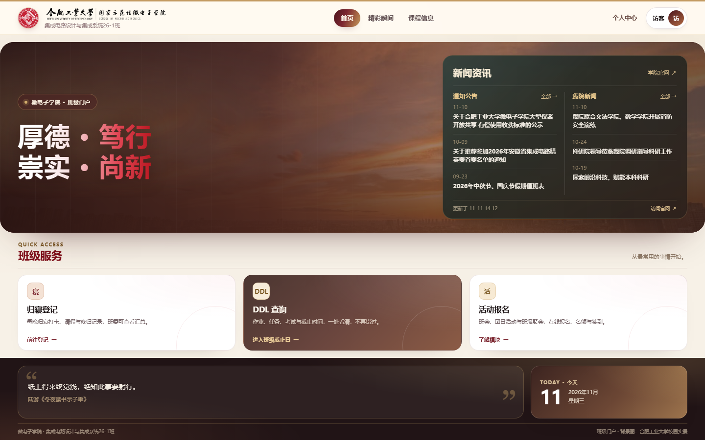
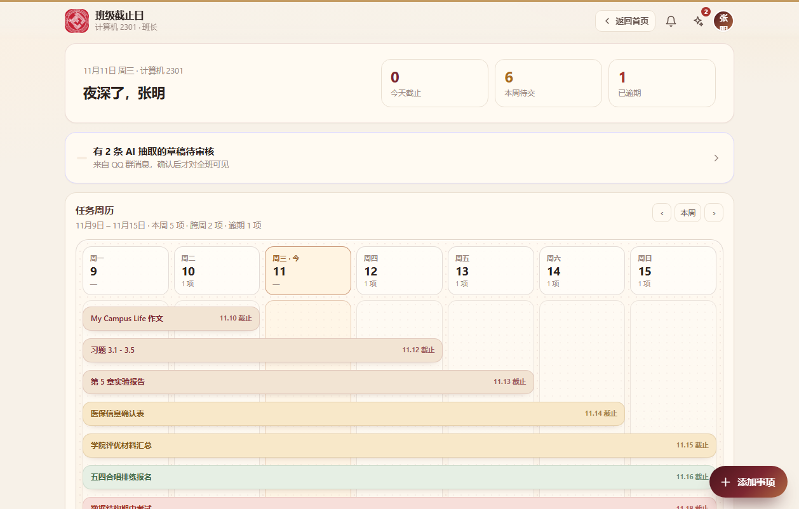
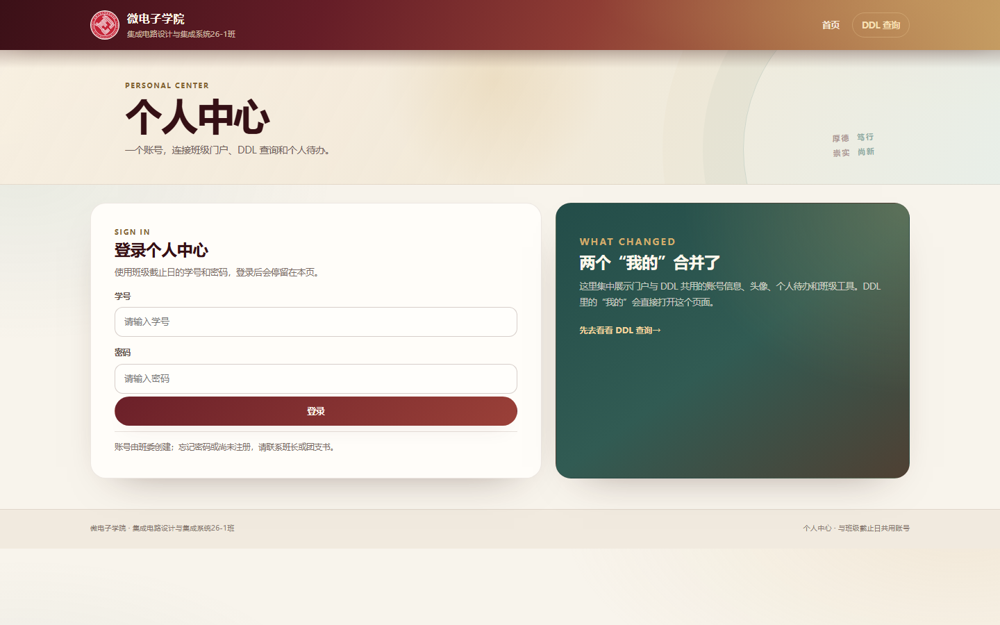
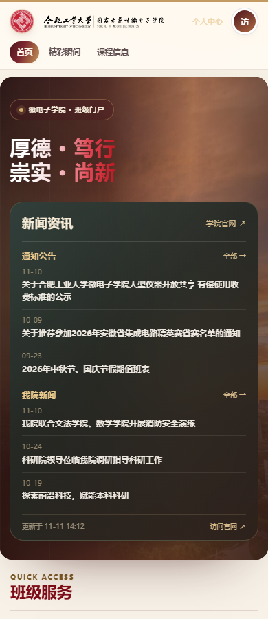

# ClassHub 班级门户与截止日聚合系统

ClassHub 是面向大学班级的一体化信息入口：把学院新闻、班级 DDL、考试/表格任务、个人待办、账号与头像放进同一套轻量系统，并提供可安装、可离线的 PWA 与 Android/Windows 客户端。

- 公网演示：<https://www.2026hfutintegratedcircuit1.com/>
- 源码仓库：<https://github.com/smallblackultra/classhub>
- DDL 查询：<https://www.2026hfutintegratedcircuit1.com/daliy/>
- 个人中心：<https://www.2026hfutintegratedcircuit1.com/personalcenter/>
- 工程报告：[docs/工程报告.pdf](docs/工程报告.pdf) ｜ [DOCX](docs/工程报告.docx)

> 仓库不包含真实班级数据库、账号清单、`.secret`、机器人 Token、服务器地址或任何生产凭据。示例数据由 `--reset` 本地生成。

## 界面

| 门户首页 | DDL 任务周历 |
| --- | --- |
|  |  |

| 个人中心 | 移动端 |
| --- | --- |
|  |  |

## 主要能力

- **班级门户**：学院新闻双栏（通知公告 / 我院新闻）、每日名言与日期、班级服务入口、院徽与校园背景。
- **DDL 管理**：作业、考试、表格、任务四类事项；草稿、审核、发布、完成、催填、报表；甘特式任务周历；班级/班委受众与权限隔离。
- **个人中心**：与 DDL 共用账号；资料、头像上传、个人待办、班级工具、修改密码、退出登录。
- **新闻抓取**：抓取微电子学院官网两个栏目，SQLite 缓存 30 分钟；失败时保留旧数据，不阻塞门户。
- **PWA / 离线**：根作用域 Service Worker 缓存三套页面外壳；已登录用户可离线查看缓存的 DDL/新闻/资料；个人待办支持离线新增、修改、删除，联网后按 `client_key` 幂等同步。
- **原生壳**：Android WebView APK（debug 签名）与 Electron/NSIS Windows 安装包（未签名），共用同一 HTTPS 站点与离线缓存；安装包仅保留在本地交付包，不随源码仓库上传。

## 技术栈

- 后端：Python 3.12 标准库 `http.server` + `sqlite3`，单进程，无 Web 框架、无第三方运行时依赖。
- 前端：Preact 10 + htm（DDL）、原生 HTML/CSS/JS（门户与个人中心），无构建步骤。
- 数据：一班一库 `data/classes/<slug>/classhub.db`；全局新闻缓存 `data/portal.db`；WAL 模式。
- 部署：Cloudflare Tunnel → OpenResty/Nginx → systemd Python 服务；静态门户与 `/api/`、`/daliy/` 同源。
- 客户端：根作用域 PWA、Android WebView、Electron 33 + electron-builder。

## 目录

```text
app/                 Python 服务、路由、领域模型、API
web/                 门户、个人中心、DDL 前端、PWA/离线脚本
bot/                 QQ 群消息接入与草稿采集（不含生产配置）
tests/               48 个 unittest，覆盖 API/门户/PWA/离线幂等
deploy/              远端静态站构建脚本
native/android/      Android WebView 工程
native/desktop/      Electron 工程
docs/                设计、数据模型、部署、架构、App/离线、工程报告
```

## 本地运行

```powershell
# 在项目根目录执行；--reset 会生成演示数据并启动服务
python -X utf8 -m app --reset --port 8000
```

打开 <http://127.0.0.1:8000/>。演示账号与密码以启动输出为准；不要在生产环境使用 `--reset`。

测试：

```powershell
python -X utf8 -m unittest discover -s tests -t . -v
```

## 工程报告

工程实践报告按论文格式编排，含中英文摘要、关键词、目录、7 章正文、参考文献与附录：

- [PDF 版](docs/工程报告.pdf)（A4，23 页）
- [Word 版](docs/工程报告.docx)
- [格式自查记录](docs/工程报告-格式自查.md)

## 文档

公开仓库保留通用设计/部署/架构/离线文档；涉及真实主机、SSH、面板与账号清单的内部运维记录未上传。

- [设计总览](docs/01-设计总览.md)
- [数据模型与接口契约](docs/02-数据模型与接口契约.md)
- [部署与运维](docs/03-部署与运维.md)
- [上线前检查清单](docs/04-上线前检查清单.md)
- [首页与总体架构](docs/06-首页与总体架构.md)
- [App 与离线使用](docs/10-App与离线使用.md)

## 数据与安全

- 仓库不包含 `data/`、`data/.secret`、`deploy/bot.env.json`、账号清单或生产数据库。
- 真实部署需自行设置 `CDH_ENV=prod`、HTTPS、会话密钥权限（0600）与每日备份；备份应包含班库、`portal.db` 和 `.secret`。
- 离线缓存保存在浏览器/客户端本地，按学号隔离；退出登录会清除缓存。缓存不替代服务器备份。
- 安卓包为 debug 签名，Windows 安装包未签名；正式分发前应完成签名与 SmartScreen 处理。

## 素材说明

院徽与校园照片用于班级门户展示，版权归原权利人；如用于其他用途请替换为获授权素材。第三方开源依赖遵循其各自许可证。

## 许可

本项目为课程工程实践作品。除第三方依赖与学校标识/照片外，代码可按班级内部教学与协作场景使用；如需再分发，请先取得相关素材与数据权利人的许可。
